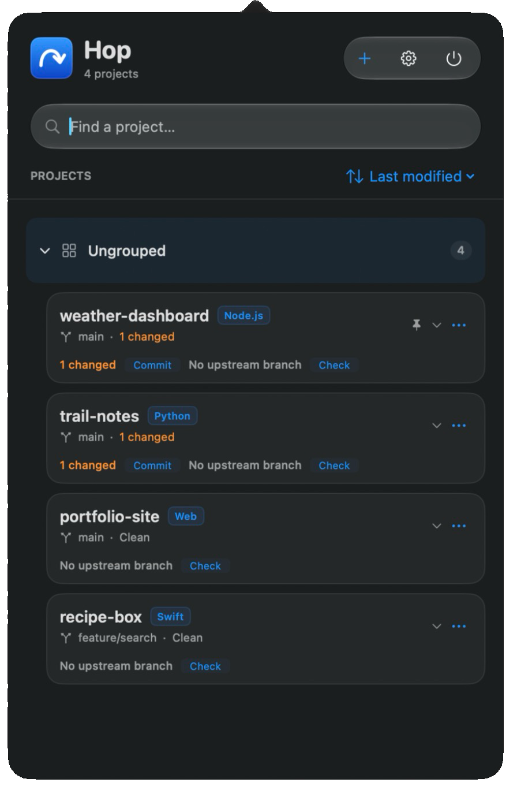
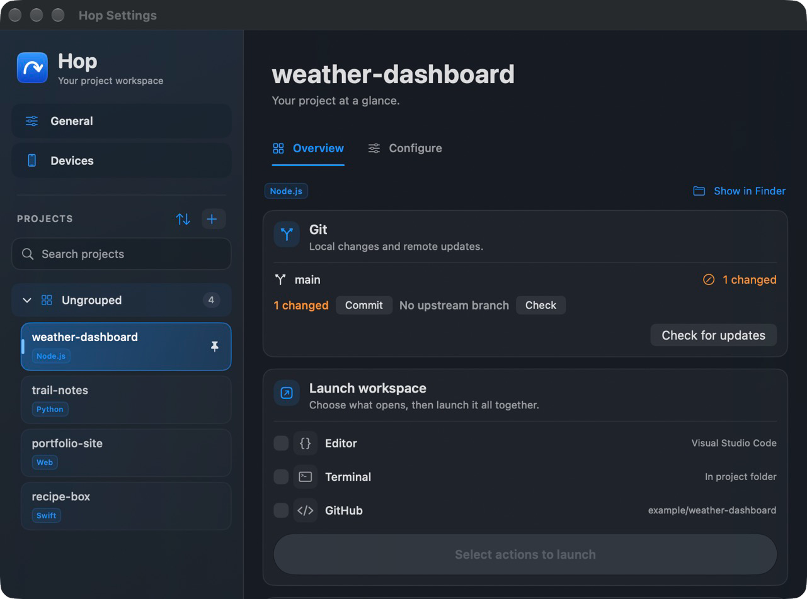

# Hop

A native macOS menu-bar workspace for your development projects. Open projects in your editor or Terminal, inspect Git changes, run local services, and manage builds and deployments from one place.

<p align="center">
  
  
</p>
<p align="center"><sub>Screenshots show sample projects created for this README.</sub></p>

## Features

- Discover projects in a selected folder, organize them into groups, and pin favorites.
- Open an editor, Terminal, Xcode, a project website, or its GitHub repository.
- Review Git status and diffs, and commit, pull, or push changes.
- Start and stop configured development services.
- Build and install supported Apple apps, with device and signing status.
- Optionally connect your own OpenAI admin API key to view project spending.

## Build from source

Requires macOS 14 or newer and Xcode with the macOS SDK. Git features use the installed Git command-line tools; project-specific builds require their own toolchains. Some GitHub features use the GitHub CLI (`gh`).

```sh
git clone https://github.com/ppratick/Hop.git
cd Hop
open Hop.xcodeproj
```

Select the **Hop** scheme and **My Mac**, then Run. Choose your project folder in Hop's settings. Review discovered commands before running them.

To build and install a local copy:

```sh
zsh build.sh
```

The script installs to `/Applications/Hop.app`. To choose another location:

```sh
HOP_APP_PATH="$HOME/Applications/Hop.app" zsh build.sh
```

Build intermediates are created in a temporary directory and removed afterward. This is a local source build; no notarized download is provided yet.

## Privacy and credentials

Hop works with local projects and uses your own development tools and accounts. Its optional OpenAI key is stored in the macOS Keychain. Never include credentials in a service command, project note, screenshot, or Git commit. Git actions affect the selected project's repository; review changes before committing or pushing.

## Tests

```sh
zsh test.sh
```

The integration runner creates its fixtures and compiler cache in a temporary directory.

## Signing your own build

The project reads `Signing.xcconfig` and an optional, ignored `Signing.local.xcconfig`. Configure your identity once for all targets:

```sh
cp Signing.local.xcconfig.example Signing.local.xcconfig
```

Edit `APP_BUNDLE_IDENTIFIER` to a unique identifier you control. Hop’s default local ad-hoc Mac build does not need an Apple Team; `DEVELOPMENT_TEAM` is available for your own signing setup. Keep the local file out of Git. Command-line build-setting overrides still work.

For an update to an existing installation, retain its bundle identifier and signing team so it keeps the same app identity and access to its saved data. Do not overwrite an existing local signing file with the example.

## License

[MIT](LICENSE). The app is free to use and modify. Optional third-party services may have their own charges and terms.
